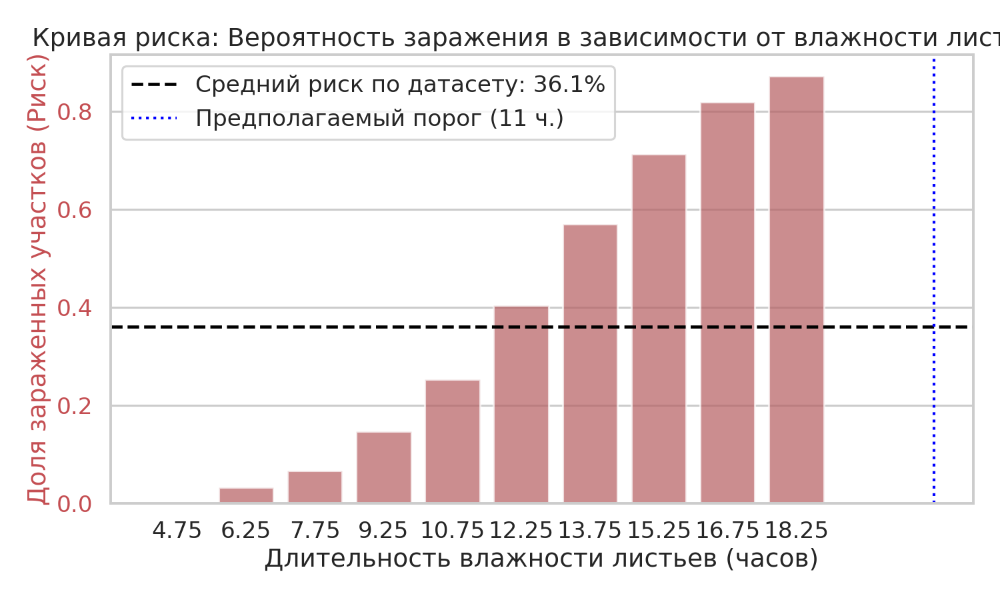
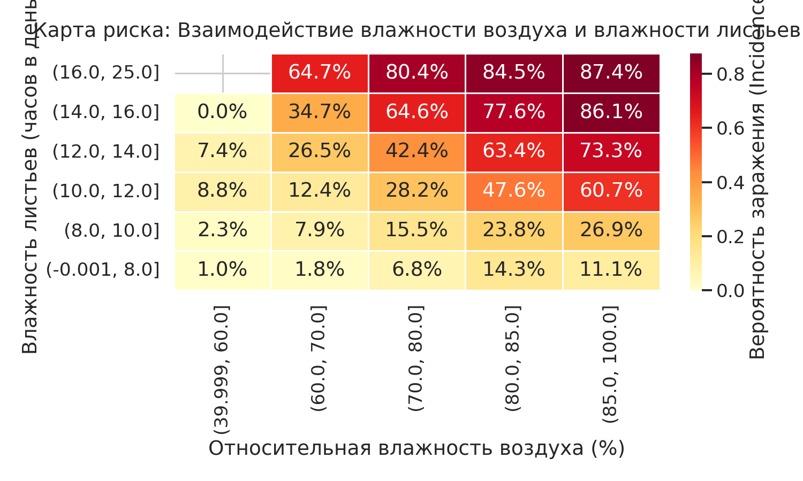
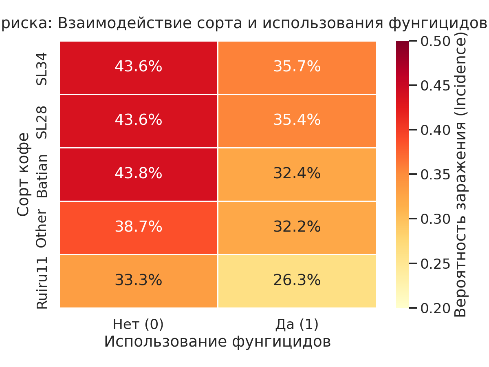
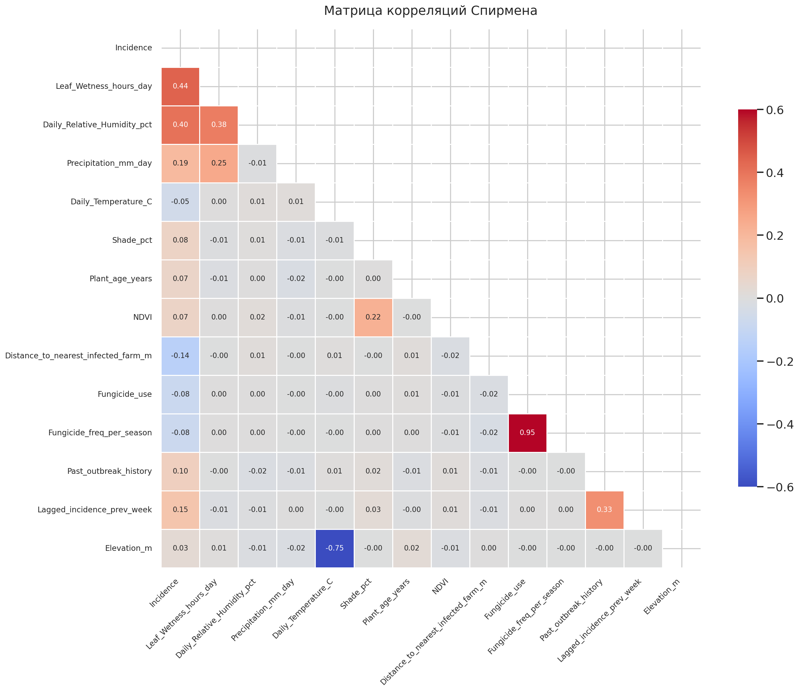

# EDA: Прогнозирование риска кофейной ржавчины (Coffee Leaf Rust)

## О проекте
**Цель:** Выявить, при каких агроклиматических условиях и практиках повышается риск развития кофейной ржавчины (*Hemileia vastatrix*).
**Данные:** [Coffee Leaf Rust Incidence Dataset (KALRO, Zenodo)](https://zenodo.org/records/17861841#1). 9850 наблюдений, 17 признаков.
**Инструменты:** Python (pandas, numpy, matplotlib, seaborn, scipy).

## Ключевые выводы
1. **Наличие свободной влаги .** Длительность увлажнения листьев > 12 ч/день и влажность воздуха > 70% резко повышают риск заражения (до 80%).
2. **Важно выбирать устойчивые сорта, но помнить о благоприятных условиях для патогена.** Устойчивый сорт Ruiru 11 имеет риск 30%, восприимчивые SL28/SL34 — 40%. Ключевым фактором все равно является наличие свободной влаги, но более сильный иммунитет у устойчивых сортов понижает риск заражения. 
3. **Профилактические обработки, а не лечебные.** Использование фунгицидов снижает риск на ~8 п.п. Наибольшая эффективность обработок достигается на полновозрастных деревьях (7–14 лет). При этом если на растении уже появились первые симптомы развитие патогена (процент степени пораженности) будет протекать одинаково в независимости от химических обработок.
4. **Пространственная изоляция.** Близость к зараженному участку (<500 м) повышает риск до 41.8% из-за распространения спор ветром/человеком/животными.

## Визуализация ключевых результатов

### Кривая риска: Влажность листьев

*Порог риска начинается с 11-12 часов.*

### Карта риска: Влажность воздуха & Влажность листьев

*Окно эпифитотии: RH > 85% и влажность листьев > 14 ч.*

### Карта риска: Сорт & Обработки

*Показывает эффективность применения обработок, как на восприимчивых, так и усточивых сортах.*

### Корреляция признаков

## Структура проекта
- [`EDA_CLR.ipynb`](https://colab.research.google.com/drive/1fibfLGodf2MUqZyAgBypvrotgTQulosO?usp=sharing) — Jupyter Notebook с полным кодом и подробным анализом признаков и их вазимодействий.
- `images_clr/` — папка с визуализациями (30 графиков).
- `data/` — исходный датасет.

## Ограничения 
- Датасет не содержит временных меток, что не позволяет учесть 4-6-недельный инкубационный период патогена (например, для анализа конкретной даты инфицирования).
- Признак `Lagged_incidence_prev_week` создает утечку данных, поэтому не может быть использован для построения моделей машинного обучения.
- Исходные данные не содержат информации о скорости ветра.

## Автор
Васильева Алиса Сергеевна — Data Scientist с образованием бакалавра агронома (профиль защита растений).
